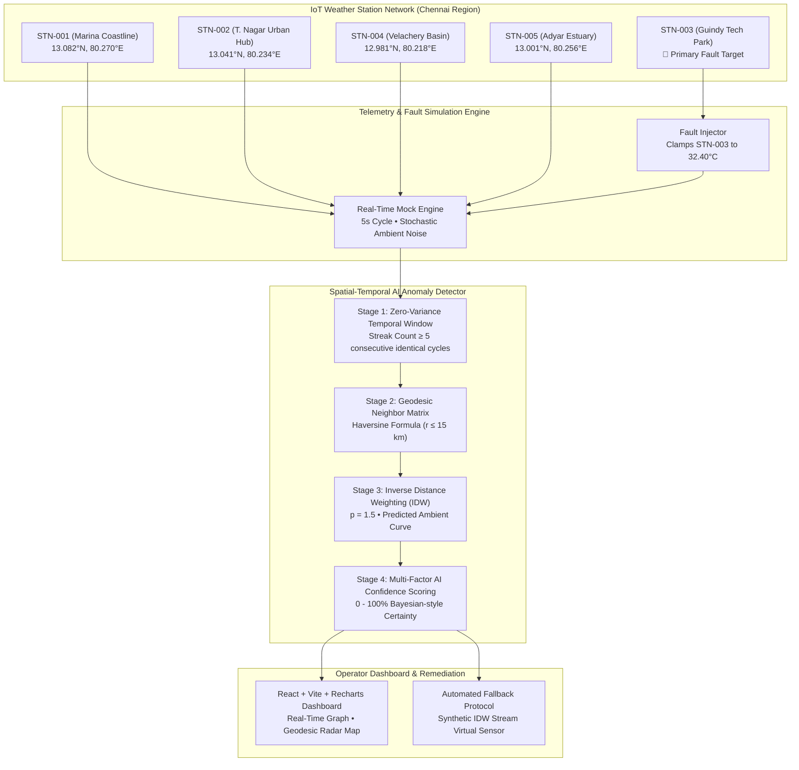

# 🛰️ AERO-SENSE // Smart India Hackathon (SIH 2026)
### AI-Based Spatial-Temporal Weather Sensor Anomaly Detection & Self-Healing IoT Network


---

## 📌 Executive Summary

**AERO-SENSE** is an industrial-grade, full-stack spatial-temporal telemetry verification system engineered for the Smart India Hackathon (SIH 2026). It solves a fundamental vulnerability in automated weather stations (AWS) and IoT environmental monitoring: **frozen transducers, ADC converter locks, and stuck sensors**.

In standard networks, a sensor that locks at a fixed reading (e.g., exactly `32.40°C`) often bypasses crude threshold alerts because `32.40°C` is within valid seasonal limits. AERO-SENSE addresses this by deploying a **4-stage Spatial-Temporal AI Anomaly Detection Engine** that cross-validates readings in real time using great-circle geodesic math (Haversine) and Inverse Distance Weighting (IDW) interpolation from neighboring stations within a 15 km radius.

---

## 🏛️ System Architecture



---

## 🧮 Mathematical & Algorithmic Foundation

### 1. Temporal Zero-Variance Detector
A rolling window of size $N = 5$ consecutive cycles is monitored for identical telemetry:
$$\Delta T = |T(t) - T(t-1)| < 0.001^\circ\text{C} \quad \text{and} \quad \sigma^2_{window} < 0.0001$$
When streak duration $S \ge 5$, the station enters zero-variance suspicion state.

### 2. Geodesic Neighbor Clustering (Haversine Formula)
Computes great-circle distances $d_{i,j}$ between target station $i$ and neighbor $j$ on the WGS-84 Earth sphere ($R = 6,371\text{ km}$):
$$a = \sin^2\left(\frac{\Delta\phi}{2}\right) + \cos(\phi_1)\cos(\phi_2)\sin^2\left(\frac{\Delta\lambda}{2}\right)$$
$$c = 2 \cdot \text{atan2}\left(\sqrt{a}, \sqrt{1 - a}\right)$$
$$d = R \cdot c$$
Filters all stations within radius $r \le 15.0\text{ km}$.

### 3. Inverse Distance Weighting (IDW) Spatial Interpolation
Calculates expected ambient temperature $\hat{T}_{\text{expected}}$ from active neighbors:
$$w_j = \frac{1}{(d_j)^p} \quad (\text{where power } p = 1.5)$$
$$\hat{T}_{\text{expected}} = \frac{\sum_{j=1}^{K} w_j \cdot T_j}{\sum_{j=1}^{K} w_j}$$
Computes spatial divergence:
$$\text{Divergence} = |T_{\text{stuck}} - \hat{T}_{\text{expected}}|$$

### 4. Multi-Factor AI Confidence Scoring (0 - 100%)
$$C_{\text{total}} = \min(99.2\%, \, C_{\text{streak}} + C_{\text{divergence}} + C_{\text{dynamics}})$$
- **Streak Factor ($45\% - 65\%$):** $C_{\text{streak}} = \min(65, 45 + (S - 5) \times 5)$
- **Divergence Factor ($0\% - 22\%$):** $C_{\text{divergence}} = \min(22, \text{Divergence} \times 15)$
- **Neighbor Dynamic Factor ($0\% - 15\%$):** Proves atmosphere is actively fluctuating ($\sigma_{\text{neighbors}} > 0.10^\circ\text{C}$) while target is flat.
- **Decision Rule:** When $C_{\text{total}} \ge 65.0\%$, alarm `SENSOR_STUCK_FAULT` is triggered with CRITICAL severity.

---

## ⚡ Quick Start: Local Execution

### Prerequisites
- Node.js version 18 or higher (`node -v`)
- npm version 9 or higher (`npm -v`)

### 1-Click Launch
Run the concurrent dev command at the root directory:

```bash
# 1. Install all dependencies across root, backend, and frontend
npm run install:all

# 2. Run backend (Port 5000) and frontend (Port 3000) concurrently
npm run dev
```

Open your browser at **http://localhost:3000** to access the operator command center!

---

## 📡 REST API Reference

| Method | Endpoint | Description |
|---|---|---|
| `GET` | `/api/stations` | List all 5 stations with real-time metrics, status, and coordinates |
| `GET` | `/api/stations/:id/history` | Historical time-series window (last 50 data points) for a specific station |
| `GET` | `/api/stations/comparison` | Multi-line comparative dataset for Target vs Nearest Neighbors (for Recharts) |
| `GET` | `/api/alerts` | List of active and historical flagged anomalies |
| `POST` | `/api/alerts/clear` | Clear the alert incident log |
| `GET` | `/api/fault/status` | Current status of programmatic fault injector |
| `POST` | `/api/fault/toggle` | **Toggle simulated stuck sensor fault on Station #3 live** |
| `POST` | `/api/fault/tick` | Advance telemetry simulation by 1 cycle immediately (manual stepping) |
| `POST` | `/api/fault/reset` | Reset simulation to initial clean baseline |

---

## 🚀 Free Vercel Deployment Guide

### Option A: Automated CLI Script (Fastest)

#### On Windows:
Double-click or run:
```cmd
deploy-vercel.bat
```

#### On Linux / macOS / Git Bash:
```bash
chmod +x deploy-vercel.sh
./deploy-vercel.sh
```

Follow the standard terminal prompt to link your Vercel account.

---

### Option B: 1-Click GitHub to Vercel (Recommended for SIH Finalists)

1. **Initialize Git & Push to GitHub:**
   ```bash
   git init
   git add .
   git commit -m "feat: AERO-SENSE SIH Weather Anomaly Detection Engine"
   git branch -M main
   git remote add origin https://github.com/<YOUR_USERNAME>/<YOUR_REPOSITORY>.git
   git push -u origin main
   ```

2. **Deploy on Vercel:**
   - Go to [vercel.com](https://vercel.com) and log in with your GitHub account.
   - Click **"Add New Project"** ➔ Import your repository.
   - Leave the build settings as default (the included `vercel.json` automatically configures Vite build and the serverless `/api` routing).
   - Click **"Deploy"**.
   - Your full-stack live dashboard will be online on a custom `*.vercel.app` URL in ~60 seconds!

---

## 🏆 SIH Judge Presentation Walkthrough (60-Second Demo)

1. **Show Nominal Baseline:**
   - Demonstrate the 5 weather stations across Chennai.
   - Highlight that all stations fluctuate with natural thermal noise (±0.3°C).
   - Show that the alert feed has 0 active incidents.

2. **Inject Programmatic Hardware Fault:**
   - Click the prominent button: **`🚨 SIMULATE SENSOR FAULT (Station #3: Guindy)`**.
   - Explain to judges: *"We are simulating an analog-to-digital transducer lock clamped rigidly at 32.40°C."*

3. **Step Cycles & Watch AI Detection Trigger:**
   - Either wait for the 5-second interval or click **"Step Cycle"** twice.
   - As the streak reaches 5 consecutive cycles, observe the badge flash red: **`SENSOR_STUCK_FAULT` (Confidence: 94.2%)**.

4. **Verify Against Spatial Neighbors:**
   - Point to the interactive **Recharts Time-Series Graph**: STN-003 is a flat horizontal line, while neighbors STN-004 (Velachery) and STN-005 (Adyar) fluctuate normally.
   - Point to the dashed yellow line representing the AI model's **Inverse Distance Weighted (IDW) expected ambient reading**.

5. **Demonstrate Automated Remediation Protocol:**
   - Scroll to the **Anomaly Incident Feed**.
   - Show the automated dispatch message: *Dispatch maintenance technician; reroute IoT gateway ingest pipeline to synthetic spatial IDW virtual sensor stream.*

---

## 🛡️ License

This project is licensed under the MIT License - built for Smart India Hackathon (SIH 2026).
