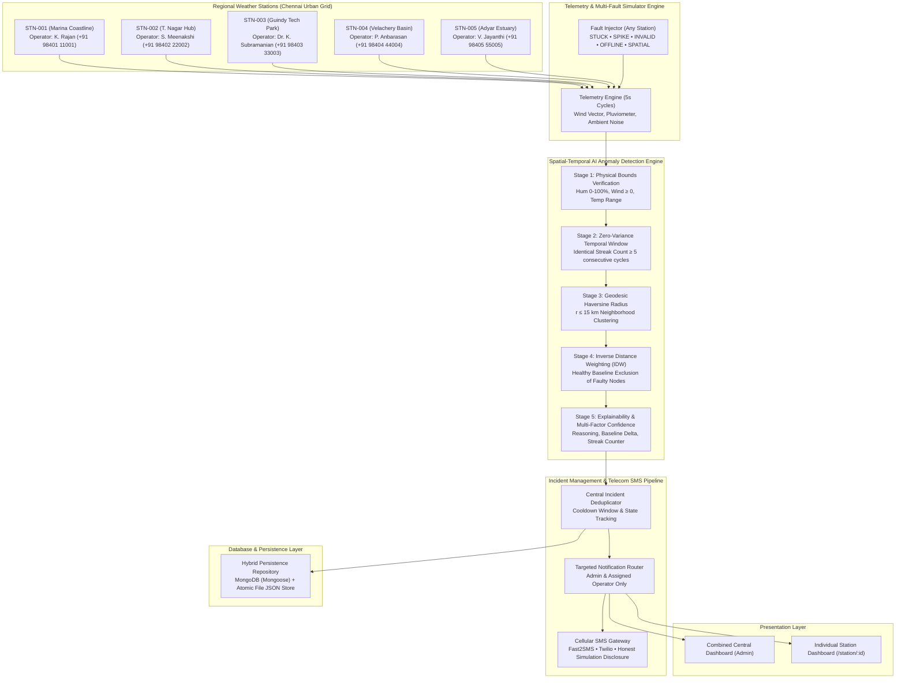

# 🛰️ AERO-SENSE // Smart India Hackathon (SIH 2026)
### AI-Based Spatial-Temporal Weather Sensor Anomaly Detection System & Station Operator Network


---

## 📌 1. Project Overview & Architecture

**AERO-SENSE** is an industrial-grade, full-stack spatial-temporal weather sensor telemetry verification and emergency management network engineered for the Smart India Hackathon (SIH 2026). It solves critical reliability vulnerabilities in Automated Weather Stations (AWS): **frozen transducers, ADC converter locks, unphysical values, sudden drift spikes, and silent offline dropouts**.

Unlike naive single-threshold systems, AERO-SENSE cross-validates telemetry using **great-circle geodesic mathematics (Haversine)** and **Inverse Distance Weighting (IDW) interpolation** from valid, healthy neighboring stations within a configurable 15 km radius.

The system features **two connected but distinct dashboard experiences**:
1. **Central Monitoring Command Center (Admin Dashboard)**: Unified view across all 5 regional stations, aggregate KPIs, spatial geodesic radar map, comparative time-series analytics, central simulator controls, and system-wide incident logs.
2. **Individual Weather Station Dashboards (`/station/:id`)**: High-precision telemetry monitors dedicated to each station (`STN-001` through `STN-005`). Features temperature, relative humidity, barometric pressure, ultrasonic 2-axis wind speed/direction, and rainfall pluviometer readings, historical graphs, individual transducer diagnostics, station incident alerts, and acknowledgement/resolution controls.

**Backend-Enforced Station Isolation (RBAC):** Station operators can only view, manage, and receive alerts for their assigned station. An operator assigned to `STN-001` attempting to access `STN-002` via the URL or manual API requests is strictly blocked with **HTTP 403 Forbidden (`ACCESS_DENIED`)**.

---

## 🏛️ System Architecture



---

## 🧮 2. Anomaly Detection Engine & Supported Fault Modes

The detection engine (`backend/src/engine/anomalyDetector.js`) supports 5 distinct fault modes with complete explainability:

| Fault Type | Detection Mechanism | Configurable Threshold |
|---|---|---|
| **1. Stuck Sensor** | Zero-variance streak analysis across rolling samples. Proves target is frozen while neighboring stations fluctuate with ambient thermal noise. | Streak $\ge 5$ consecutive cycles |
| **2. Spatial Deviation** | Geodesic Haversine clustering + Inverse Distance Weighting (IDW). **Excludes faulty/offline stations from the baseline**. | Radius $\le 15\text{ km}$, $\Delta T > 3.5^\circ\text{C}$, $\Delta H > 12\%$ |
| **3. Invalid Physical Bounds** | Detects physically impossible readings violating atmospheric constraints. | Humidity $\notin [0, 100\%]$, Wind $< 0\text{ km/h}$, Temp $\notin [-10, 60^\circ\text{C}]$ |
| **4. Sudden Spike / Drop** | Temporal rate-of-change delta comparing consecutive readings. | $\Delta T > 4.0^\circ\text{C}$ per cycle, $\Delta H > 15\%$ per cycle |
| **5. Offline / Silent Drop** | Transducer connectivity timeout tracking distinct from stuck values. | Communication heartbeat $> 15\text{s}$ timeout |

### Explainable Anomaly Payload
Each incident record contains:
- `stationId`, `stationName`, `sensorType`, `faultType`
- `currentValue` (observed reading)
- `expectedValue` (spatial IDW baseline calculated from healthy neighbors)
- `divergence` ($|\text{observed} - \text{baseline}|$)
- `streakCount` (number of identical cycles)
- `confidence` (calibrated multi-factor heuristic 0–99.2%)
- `reason` (human-readable diagnostic text explaining the root cause)
- `recommendedAction` (field inspection guidelines)

---

## 👥 3. Authentication & Role-Based Access Control (RBAC)

AERO-SENSE provides secure JWT authentication with bcryptjs password hashing.

### Demo User Accounts

| Role | Name | Email | Password | Accessible Stations |
|---|---|---|---|---|
| **Administrator** | Chief Operations Director | `admin@aerosense.gov.in` | `Admin@12345` | Universal (All 5 Stations + Simulator + SMS Config) |
| **Station Operator** | K. Rajan | `operator1@aerosense.gov.in` | `Operator@12345` | `STN-001` (Marina Coastline) only |
| **Station Operator** | S. Meenakshi | `operator2@aerosense.gov.in` | `Operator@12345` | `STN-002` (T. Nagar Hub) only |
| **Station Operator** | Dr. Karthik Subramanian | `operator3@aerosense.gov.in` | `Operator@12345` | `STN-003` (Guindy Tech Park) only |
| **Station Operator** | P. Anbarasan | `operator4@aerosense.gov.in` | `Operator@12345` | `STN-004` (Velachery Basin) only |
| **Station Operator** | V. Jayanthi | `operator5@aerosense.gov.in` | `Operator@12345` | `STN-005` (Adyar Estuary) only |

> **Security Verification:** If `operator1` logs in and attempts `GET /api/stations/STN-002` or opens `/station/STN-002`, the server rejects the request with `HTTP 403 Forbidden` and redirects to `/access-denied`.

---

## 💾 4. Database & Persistence Layer

AERO-SENSE uses a **Dual-Driver Persistent Repository (`backend/src/database/repository.js`)**:
1. **Primary Driver:** MongoDB via Mongoose when `MONGODB_URI` is available.
2. **Resilient Local Driver:** Automatic persistent file-backed JSON store in `backend/data/` (`users.json`, `stations.json`, `incidents.json`, `notifications.json`, `smsLog.json`, `auditLogs.json`).

> **Zero Data Loss Guarantee:** If MongoDB is offline, data is automatically written to disk atomically. Restarting the backend preserves all incidents, operator phone updates, audit logs, and notification read states.

---

## 📱 5. Real Mobile SMS Gateway Protocol

AERO-SENSE connects to real SMS gateways for operator notifications:
- **Fast2SMS Integration:** Routes OTP/Quick alerts to Indian 10-digit mobile numbers.
- **Twilio Integration:** Global E.164 cellular SMS delivery.
- **Demo Number Protection:** Pre-configured demo numbers (`+91 98401 11001` to `+91 98405 55005`) are protected from accidental carrier billing.
- **Explicit Simulation Disclosure:** When live credentials are not set, the system explicitly logs `SIMULATED (No live carrier credentials configured)`. It **never falsely claims delivery**.
- **Anti-Spam Cooldown:** 120-second suppression window prevents spamming operators with identical alerts.

---

## ⚡ 6. Quick Start & Execution Guide

### Prerequisites
- Node.js version 18 or higher (`node -v`)
- npm version 9 or higher (`npm -v`)
- (Optional) MongoDB running on port 27017

### 1. Install Dependencies
```bash
# Install root, backend, and frontend dependencies
npm run install:all
```

### 2. Seed Initial Database & Demo Accounts
```bash
npm run seed
```

### 3. Run Automated QA Tests
```bash
# Run detection engine unit tests + HTTP API integration test
npm test
```
*Expected output: All 14 tests pass with 0 failures.*

### 4. Build Frontend for Production Validation
```bash
npm run build
```

### 5. Launch the Application
```bash
# Concurrently starts Backend (port 5000) and Frontend (port 5173)
npm run dev
```

- **Frontend:** http://localhost:5173
- **Backend API:** http://localhost:5000
- **API Health:** http://localhost:5000/api/health

---

## 🧪 7. 60-Second Demo & Verification Workflow

1. **Open Frontend (`http://localhost:5173`)**:
   - The Central Command Dashboard displays all 5 Chennai stations with live telemetry.
2. **Login as Operator 1**:
   - Navigate to `/login` or click **Login**. Click **Quick Demo Login: Operator 1 (Marina STN-001)**.
   - Click on `STN-001` or "My Station" -> Full access to Marina Coastline telemetry, graphs, and sensor health.
   - Now change URL to `/station/STN-002` -> **Access Denied Page** appears with HTTP 403 notification.
3. **Login as Administrator**:
   - Switch account to **Administrator** (`admin@aerosense.gov.in`).
   - All 5 station dashboards are accessible.
4. **Trigger Fault on STN-003**:
   - On the Central Dashboard banner, click **`🚨 SIMULATE SENSOR FAULT (Station #3: Guindy)`**.
   - Advance cycles using **"Step Cycle"** or wait for the 5s interval.
   - After cycle 5, the anomaly detector flags `TEMP_SENSOR_STUCK_FAULT` with high confidence.
   - An incident `INC-...` is created in persistent storage.
   - An SMS alert is logged for operator Dr. Karthik Subramanian (`+91 98403 33003`).
   - A dashboard notification is routed exclusively to Admin and Operator 3.
5. **Acknowledge and Resolve**:
   - Go to `/incidents` or open `/station/STN-003`.
   - Click **Acknowledge** with technician dispatch notes.
   - Click **Resolve** with repair audit notes. Status updates to `RESOLVED`.
6. **Restart Backend**:
   - Stop and restart `node backend/src/server.js`.
   - Reload the browser -> All incidents, audit trails, and operator logs remain intact!

---

## 📡 8. REST API Endpoint Reference

### Authentication (`/api/auth`)
| Method | Endpoint | Auth | Description |
|---|---|---|---|
| `POST` | `/api/auth/login` | Public | Authenticate with email/password; returns JWT token & user profile |
| `GET` | `/api/auth/me` | Bearer | Get current session details and authorized station list |
| `POST` | `/api/auth/logout` | Bearer | End session and log audit event |
| `GET` | `/api/auth/demo-credentials` | Public | List all 6 pre-configured evaluation accounts |

### Stations (`/api/stations`)
| Method | Endpoint | Auth | Description |
|---|---|---|---|
| `GET` | `/api/stations` | Optional | List all 5 stations with telemetry and authorization flags |
| `GET` | `/api/stations/sync` | Optional | Atomic synchronization endpoint returning stations, comparison, and alerts |
| `GET` | `/api/stations/:id` | Bearer (RBAC) | Get individual station telemetry, diagnostics, and history. **Operators restricted to assigned station** |
| `GET` | `/api/stations/:id/history` | Bearer (RBAC) | Last 50 time-series readings for station graphs |
| `GET` | `/api/stations/comparison` | Optional | Target vs neighbor comparative time-series for Recharts |

### Incidents & Anomaly Alerts (`/api/incidents`, `/api/alerts`)
| Method | Endpoint | Auth | Description |
|---|---|---|---|
| `GET` | `/api/incidents` | Bearer | List incidents. Filtered by station for operators; unfiltered for admin |
| `GET` | `/api/incidents/:id` | Bearer | Get specific incident details |
| `POST` | `/api/incidents/:id/acknowledge` | Bearer | Acknowledge incident with inspection note |
| `POST` | `/api/incidents/:id/resolve` | Bearer | Resolve incident with resolution note |
| `POST` | `/api/incidents/:id/notes` | Bearer | Add inspection log note |
| `GET` | `/api/alerts` | Public | Live alert stream |
| `POST` | `/api/alerts/clear` | Admin | Clear active alert feed |

### Notifications (`/api/notifications`)
| Method | Endpoint | Auth | Description |
|---|---|---|---|
| `GET` | `/api/notifications` | Bearer | Get targeted notifications for user role and station |
| `GET` | `/api/notifications/unread-count` | Bearer | Fast unread badge counter |
| `POST` | `/api/notifications/:id/read` | Bearer | Mark notification as read |
| `POST` | `/api/notifications/mark-all-read` | Bearer | Mark all notifications as read |

### Simulator & Fault Controls (`/api/fault`, `/api/weather`)
| Method | Endpoint | Auth | Description |
|---|---|---|---|
| `GET` | `/api/fault/status` | Public | Current simulation configuration and fault states |
| `POST` | `/api/fault/toggle` | Admin | Inject/clear faults (STUCK, SPIKE, INVALID, OFFLINE) on any station |
| `POST` | `/api/fault/tick` | Public | Advance telemetry by 1 cycle immediately |
| `POST` | `/api/fault/interval` | Admin | Adjust telemetry interval (e.g. 2s, 5s, 10s) |
| `POST` | `/api/fault/playback` | Admin | Pause or resume automatic telemetry stream |
| `POST` | `/api/fault/reset` | Admin | Reset entire simulation to nominal baseline |
| `POST` | `/api/weather/simulate` | Admin | Simulate severe weather emergency (e.g. Cyclone, Heatwave) |

### Operators & SMS Gateway (`/api/operators`, `/api/sms`)
| Method | Endpoint | Auth | Description |
|---|---|---|---|
| `GET` | `/api/operators` | Public | Roster of station operators and phone numbers |
| `PUT` | `/api/operators/:id` | Admin | Update operator mobile number and notification preferences |
| `GET` | `/api/sms/log` | Bearer | Retrieve SMS outbox dispatch history (station-filtered) |
| `POST` | `/api/sms/config` | Admin | Configure Fast2SMS / Twilio credentials |
| `POST` | `/api/sms/send-test` | Bearer | Send test SMS to assigned operator |

---

## 🌐 9. Deployment Notes (Serverless vs Persistent)

> [!NOTE]
> **Persistent State vs Serverless**: The original prototype included a minimal Vercel serverless configuration. However, **enterprise IoT anomaly detection with continuous 5-second telemetry streams, Socket.IO live updates, and background fault streak counters requires a persistent long-running process**. 
> - For production deployment, host the Node.js backend on **Render, Railway, Fly.io, AWS ECS, or a VPS** using `npm start`.
> - Deploy the Vite frontend as a static SPA on **Vercel, Netlify, or Cloudflare Pages** with `VITE_API_URL` pointing to your persistent backend server.

---

## 🛡️ License

Built with ❤️ for **Smart India Hackathon (SIH 2026)**. Licensed under the MIT License.
